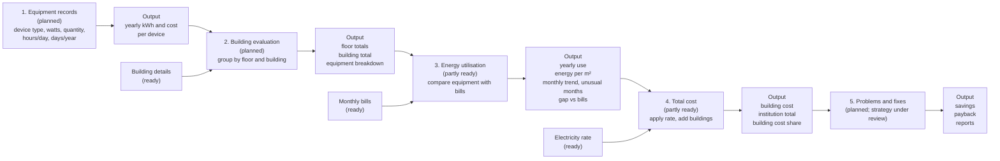

# Energy-Audit-App

Multi-institution energy audit system built with Flask, MySQL, Jinja2, and vanilla JavaScript.

## Tech Stack

- **Frontend:** server-rendered Jinja2 templates, vanilla JavaScript, plain CSS, Chart.js
- **Backend:** Python 3, Flask, SQLAlchemy, PyJWT, bcrypt, mysql-connector
- **Database:** MySQL

## Architecture

| Component | Responsibility |
|---|---|
| Browser | Jinja pages, form handling, charts, session token storage, planned offline cache |
| Flask API | Authentication, institution scoping, validation, analysis orchestration, reports |
| MySQL | Institutions, users, buildings, monthly energy records, planned equipment/findings data |
| Analysis module | Pure functions for annual kWh, cost, EUI, anomalies, comparison, aggregation |

Authentication uses JWT Bearer tokens. The institution is always taken from the token. Cross-tenant access returns `404`.

### Information flow



| Status | Meaning |
|---|---|
| Ready | Implemented and working |
| Partly ready | Some parts implemented; remaining parts planned |
| Planned | Intended feature, not implemented |
| Strategy under review | Feature is intended, but the calculation or benchmark method is not finalized |

## Formulas

Amounts are rounded to 2 decimal places unless stated otherwise.

### Implemented formulas

**Annual energy and cost**

$$
\text{annual kWh} = \mathrm{round}\left(\sum_{m=1}^{n} \text{kWh}_m,\ 2\right)
$$

$$
\text{annual cost} = \mathrm{round}\left(\sum_{m=1}^{n} \text{cost}_m,\ 2\right)
$$

**Monthly cost from the standard rate**

$$
\text{monthly cost} = \text{kWh} \times \text{standard rate per kWh}
$$

The API requires a monthly cost. The UI fills the cost from the standard rate when the field is left blank.

**Energy Use Intensity (EUI)**

$$
\text{EUI} = \mathrm{round}\left(\frac{\text{annual kWh}}{\text{floor area in m}^2},\ 2\right)
$$

| Months recorded | Completeness label |
|---:|---|
| 12 or more | `complete` |
| 6 to 11 | `partial` |
| Fewer than 6 | `insufficient` |

EUI is calculated for any non-empty set of records. The completeness label is separate.

**Anomaly detection**

For month `i`, the baseline is the average of all other months for the same building:

$$
\text{baseline}_i = \mathrm{round}\left(\frac{\sum_{j \ne i} \text{kWh}_j}{n - 1},\ 2\right)
$$

A month is an anomaly only when:

$$
\text{kWh}_i > 1.30 \times \text{baseline}_i
$$

The percentage above baseline is:

$$
\text{percent above}_i = \mathrm{round}\left(\frac{\text{kWh}_i - \text{baseline}_i}{\text{baseline}_i} \times 100,\ 2\right)
$$

Rules:

- The month being tested is excluded from its own baseline.
- The comparison is strict `>`, not `>=`.
- A building with one record produces no anomalies.
- Dashboard anomalies are per-building month anomalies, not anomalies of the institution total.
- The current code does not guard a zero baseline when all other months are zero.

**Dashboard totals**

$$
\text{total kWh} = \sum_{b=1}^{B} \text{annual kWh}_b
$$

$$
\text{total cost} = \sum_{b=1}^{B} \text{annual cost}_b
$$

$$
\text{monthly total}_m = \sum_{b=1}^{B} \text{kWh}_{b,m}
$$

Dashboard totals include buildings with incomplete data. Completeness is reported through `eui_note`.

**Comparison warning**

If the selected buildings have more than one building type, the comparison response includes:

```text
Comparison may not be fair because building types differ between buildings.
```

### Planned formulas

**Equipment annual energy**

$$
\text{equipment annual kWh} = \frac{\text{watts} \times \text{quantity} \times \text{hours/day} \times \text{days/year}}{1000}
$$

**Floor and building totals**

$$
\text{floor total} = \sum \text{equipment kWh on the floor}
$$

$$
\text{typical floor contribution} = \text{floor total} \times \text{number of identical floors}
$$

$$
\text{building total} = \sum \text{typical floor contributions} + \sum \text{special floor kWh}
$$

**End-use share**

$$
\text{category share} = \frac{\text{category kWh}}{\text{building inventory kWh}} \times 100
$$

**Reconciliation gap**

$$
\text{gap} = \frac{\text{billed kWh} - \text{inventory kWh}}{\text{billed kWh}} \times 100
$$

**Building cost share**

$$
\text{building cost share} = \frac{\text{building cost}}{\text{institution total cost}} \times 100
$$

## Audit Findings and Recommendations (Planned)

Intended features:

- Record findings by area, location, problem, improvement, priority, and optional photo
- Maintain a library of improvement measures
- Record estimated cost, estimated annual saving, payback, status, and estimate label
- Include findings and recommendations in building reports

**Implementation status: strategy under review.** The method for estimating savings, calculating payback, and deciding whether to use standards, benchmarks, or defined thresholds is not finalized. No benchmark or threshold is claimed as implemented.

## Offline Mode (Planned, Not Implemented)

Intended behaviour:

- Cache records on the device after they are pulled from the server
- Allow users to create or update records while offline
- Store offline writes locally in a queue with temporary IDs and timestamps
- Send queued writes to the remote server when the connection returns
- Show pending, synced, and failed states
- Handle duplicate monthly records using the existing `(building_id, month)` uniqueness rule
- Use idempotency keys for retried writes
- Resolve conflicts explicitly; the conflict policy is not finalized

The intended read cache is IndexedDB. The session token currently uses `localStorage`.

## Feature Checklist

### Implemented

- [x] Institution registration and login
- [x] JWT Bearer authentication
- [x] Admin and auditor roles
- [x] Institution settings: name, currency, standard electricity rate, maximum buildings
- [x] User management
- [x] Building create, edit, delete, and building limit enforcement
- [x] Monthly energy records: kWh and cost
- [x] CSV import with validation and confirmation
- [x] Automatic monthly cost from the standard rate
- [x] Annual kWh and annual cost
- [x] EUI with completeness labels
- [x] Monthly analysis series
- [x] Anomaly detection
- [x] Dashboard totals, monthly chart, anomaly list, and building table
- [x] Building comparison with fairness warning
- [x] 81 tests passing

### Planned

- [ ] Floor records: typical floors and special floors
- [ ] Equipment records per floor
- [ ] Equipment annual kWh and cost
- [ ] Floor totals and building equipment totals
- [ ] End-use breakdown by equipment category
- [ ] Reconciliation gap between billed energy and equipment inventory
- [ ] Building cost share
- [ ] Audit findings
- [ ] Recommendations and measure library
- [ ] Savings, payback, and recommendation ranking (strategy under review)
- [ ] Building report preview
- [ ] PDF and print reports
- [ ] Data export
- [ ] Offline read cache
- [ ] Offline write queue
- [ ] Automatic sync when the connection returns
- [ ] Pending, synced, and failed sync states
- [ ] Demo seed data
- [ ] Platform super-admin for institution lifecycle and cross-institution support

## Run Locally

1. Create a virtual environment and install dependencies: `pip install -r requirements.txt`
2. Copy `.env.example` to `.env` and set `MYSQL_*`, `JWT_SECRET`, and `CORS_ORIGINS`.
3. Create the MySQL database: `"venv\Scripts\python.exe" create_database.py`
4. Apply migrations: `"venv\Scripts\python.exe" -m alembic upgrade head`
5. Run tests: `"venv\Scripts\python.exe" -m pytest -q`
6. Start the server: `"venv\Scripts\python.exe" run.py`

## Documentation

- [Architecture and information flow](./docs/architecture.md)
- [API contract](./docs/api.md)
- [Analysis formulas](./docs/formulas.md)
- [What has been built](./docs/what-has-been-built.md)
- [Phase tracking](./PHASE_TRACK.md)
