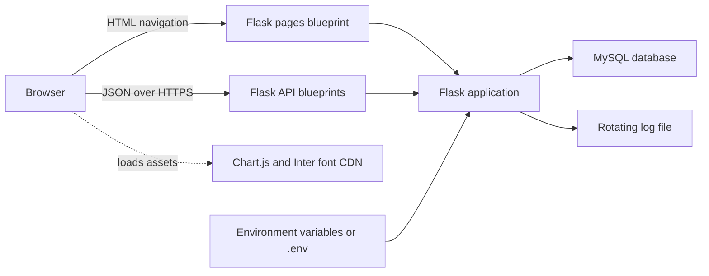
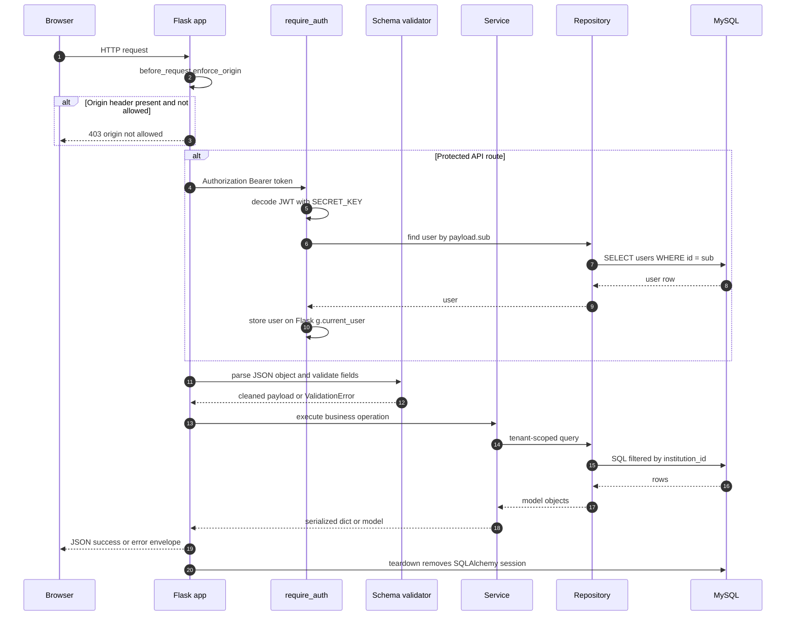
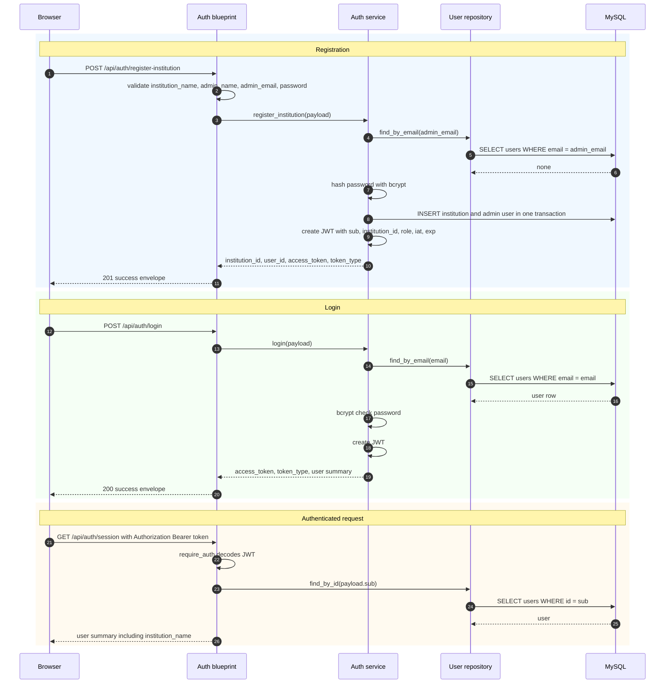
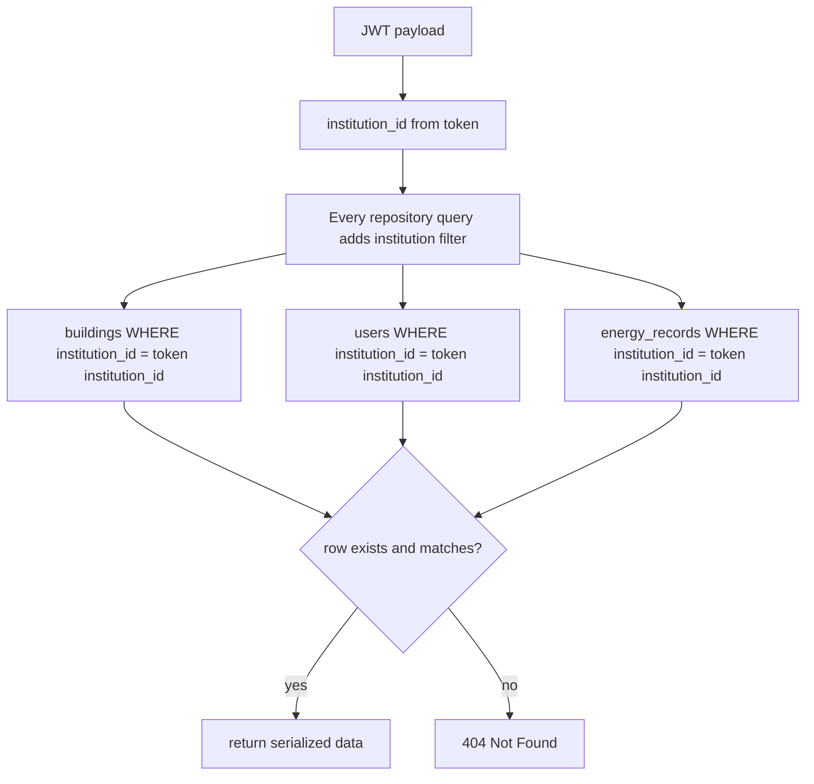
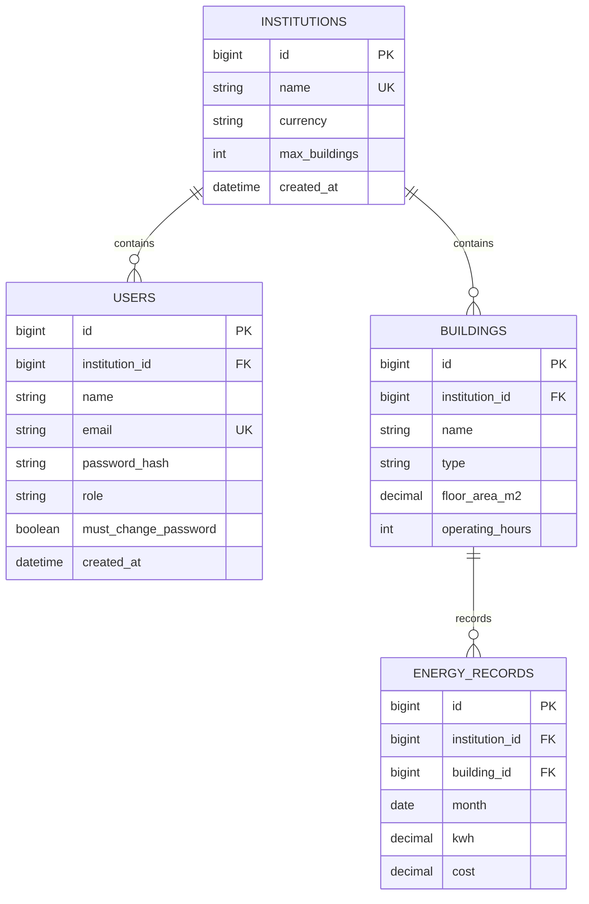
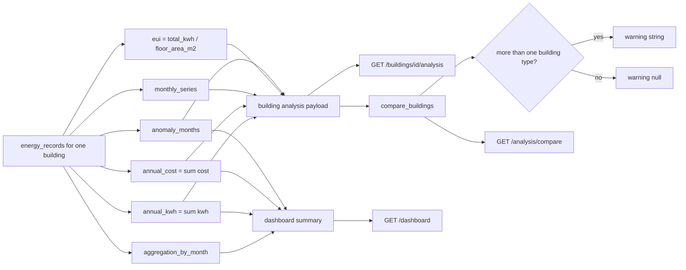
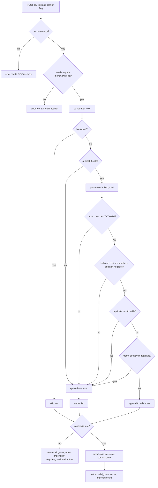
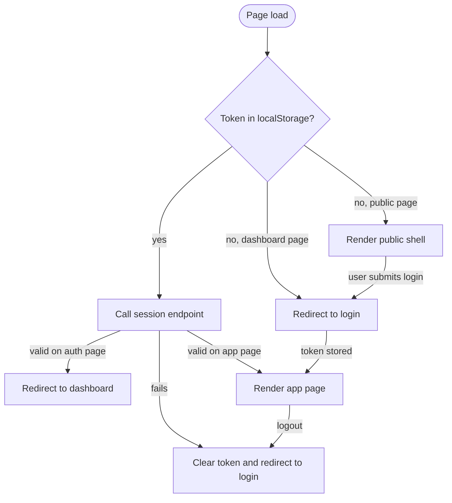
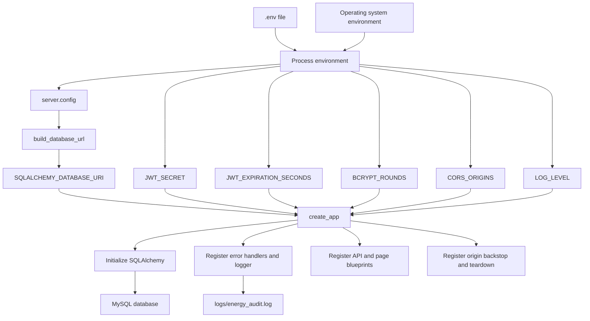

# Architecture — Information Flow

Related docs: [API reference](api.md) · [Formulas](formulas.md) · [What has been built](what-has-been-built.md)

This document explains how information moves through the system: requests, authentication, tenant scoping, database access, analysis, CSV ingestion, and configuration. It contains no file-tree diagrams.

## 1. System context



The browser loads server-rendered HTML from the pages blueprint and then calls the JSON API directly with the stored bearer token. The Flask application is the only component that talks to MySQL. All persistence, tenant checks, and calculations happen server-side.

## 2. Request lifecycle



The invariant is one commit per request and one session cleanup per application context teardown. Services call repositories; blueprints never query the ORM directly.

## 3. Authentication and session flow



The token payload is:

```json
{
  "sub": "1",
  "institution_id": "1",
  "role": "admin",
  "iat": 1760000000,
  "exp": 1760003600
}
```

The token is signed with HS256 using `SECRET_KEY`, which is populated from `JWT_SECRET`. The browser stores the token under `energy_audit_token` and sends it as `Authorization: Bearer <token>`. The server never uses cookies for identity.

## 4. Tenant isolation flow



Two database constraints enforce the same rule structurally:

- `buildings` has a unique key on `(institution_id, id)`.
- `energy_records` has a composite foreign key from `(institution_id, building_id)` to `buildings(institution_id, id)`.

The scope always comes from the JWT. URL parameters and request bodies never supply `institution_id`. Cross-tenant access therefore looks identical to a missing row: the server returns 404 rather than revealing that the row exists elsewhere.

## 5. Data model



Important column semantics:

- `energy_records.month` stores the first day of the month. The API always exposes it as `YYYY-MM`.
- `energy_records` is unique on `(building_id, month)`, so a building cannot have two records for the same month.
- `buildings` is unique on `(institution_id, name)` and on `(institution_id, id)`.
- `users.email` is globally unique.
- `buildings.floor_area_m2` must be greater than 0.
- `buildings.operating_hours` must be between 1 and 24.
- `energy_records.kwh` and `energy_records.cost` must be greater than or equal to 0.
- Deleting an institution cascades to users and buildings; deleting a building cascades to its energy records.

## 6. Analysis pipeline



The analysis module is intentionally pure: it receives lists of model objects or dictionaries and returns plain dictionaries. It does not query the database. The dashboard service is the orchestration layer that fetches data, calls the pure functions, and assembles the response.

## 7. CSV import flow



The parser is a pure utility. The service adds the database-existence check, sorts errors by row number, and only writes when `confirm` is true. Invalid rows never block valid rows from importing.

## 8. Frontend session gate



The HTML pages are public shells. The server does not redirect unauthenticated HTML requests; it returns the page and the client JavaScript performs the gate. This avoids a redirect loop caused by browser navigation not carrying the bearer token. Actual data protection still happens on every API call through `require_auth`.

## 9. Configuration and startup flow



`MYSQL_PORT` is omitted from the SQLAlchemy URI when the environment variable is empty. That keeps managed hosts such as PythonAnywhere from receiving `host:` with a blank port and raising `ValueError`. If `MYSQL_PORT` is set, it is appended as `host:port`.

## 10. Key invariants

- Identity always comes from the bearer token, never from a cookie, URL, or request body.
- Every tenant-owned query is filtered by the token's `institution_id`.
- Cross-tenant resources return 404, not 403.
- Success responses use `status: "success"`; error responses use a numeric `status` equal to the HTTP status code.
- Request bodies must be JSON objects. Non-JSON bodies and JSON arrays are rejected with 400.
- Only the register-institution and login endpoints are public. Every other API endpoint requires a bearer token.
- Roles are enforced with `require_role` on the server. Admin-only endpoints are user management and institution updates.
- All database writes are committed once per request by the service layer.
- Analysis functions are pure and unit-testable without a database.
