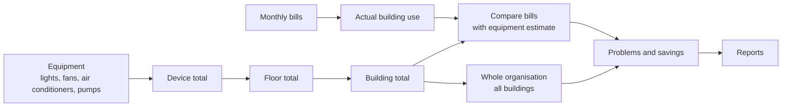
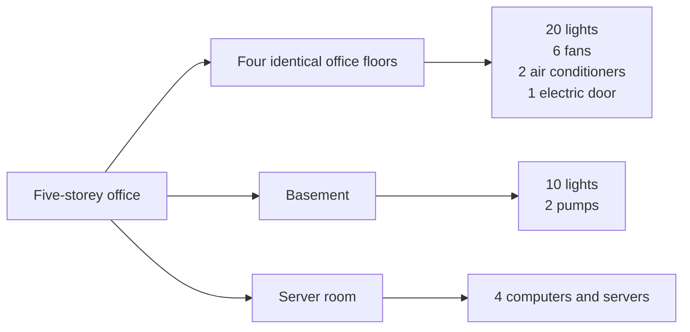

# Simplified Architecture — plain-English version

> In one sentence: The app records how much electricity a building uses, explains where it goes, adds it up for the whole organisation, and turns it into costs, problems, savings, and reports.

This version is written to be read aloud. It uses everyday words. It covers what is working today and what is still planned.

## 1. The big idea

A building uses electricity in many places: lights, fans, air conditioners, pumps, doors, computers, and other equipment. The app records each device and works out how much electricity it uses in a year. It then adds the devices up for a floor, the floors up for a building, and the buildings up for the whole organisation (called an institution in the app).

At the same time, the app records the monthly electricity bills. The bills show what the building actually used and paid. The equipment list shows why the building used that electricity. When the two do not match, the difference is the gap — and that gap tells us what to investigate.

The chain is simple:

```text
Equipment → floor → building → organisation → problems → reports
```

## 2. The flow



Read it left to right:

- The equipment side builds the number from the devices up.
- The bill side starts from what was actually used and paid.
- The comparison shows whether the two agree.
- The problems and reports turn the numbers into action.

## 3. How a building is set up

A building has floors. Floors are of two kinds:

| Floor type | How it is entered | Example |
|---|---|---|
| Typical floor | Enter it once, then say how many identical floors there are | Four identical office floors |
| Special floor | Enter each one separately | Basement, server room, kitchen, parking, reception |

The rule is simple: enter the repeated floor once and multiply it. Enter special floors one by one.



The app also stores the building's name, type, floor area, and opening hours.

For each device, the app needs five simple facts:

1. What it is — for example, a light or a fan
2. Its power rating in watts
3. How many there are
4. How many hours a day it runs
5. How many days a year it runs

Watts tell us how much power the device draws when it is switched on.

## 4. How the numbers are worked out

For one device:

```text
watts × how many × hours a day × days a year ÷ 1,000 = kWh a year
```

kWh is just a unit of electricity. A 1,000-watt device running for one hour uses 1 kWh.

For a typical floor:

```text
floor total = add up all the devices on that floor
floor contribution = floor total × number of identical floors
```

For the building:

```text
building total = all typical floor contributions + all special floors
```

For cost:

```text
cost = kWh × price per kWh
```

### Worked example

A five-storey office has four identical office floors and one basement.

| Where | What is there | Yearly electricity |
|---|---|---:|
| One office floor | 20 lights, 18 W, 10 hours a day, 250 days | 900.0 kWh |
| One office floor | 6 fans, 60 W, 8 hours a day, 250 days | 720.0 kWh |
| One office floor | 2 air conditioners, 1,500 W, 6 hours a day, 250 days | 4,500.0 kWh |
| One office floor | 1 electric door, 200 W, 2 hours a day, 250 days | 100.0 kWh |
| Basement | 10 lights, 18 W, 12 hours a day, 365 days | 788.4 kWh |
| Basement | 2 pumps, 750 W, 4 hours a day, 365 days | 2,190.0 kWh |

Then:

```text
One office floor = 900 + 720 + 4,500 + 100 = 6,220 kWh
Four office floors = 6,220 × 4 = 24,880 kWh
Basement = 788.4 + 2,190 = 2,978.4 kWh
Building total = 24,880 + 2,978.4 = 27,858.4 kWh
Cost at KSh 21.84 per kWh = 27,858.4 × 21.84 = KSh 608,427.46
```

If the bills add up to 31,000 kWh, the equipment list explains 27,858.4 kWh. The difference is:

```text
31,000 − 27,858.4 = 3,141.6 kWh
3,141.6 ÷ 31,000 × 100 = 10.1%
```

So the equipment explains about 90% of the bill. The remaining 10% is the gap to investigate. It could be equipment that was missed, a billing problem, shared areas, or a change in use.

Where the electricity goes:

| Type of equipment | Yearly electricity | Share of total |
|---|---:|---:|
| Lights | 4,388.4 kWh | 15.8% |
| Fans | 2,880.0 kWh | 10.3% |
| Air conditioners | 18,000.0 kWh | 64.6% |
| Electric doors | 400.0 kWh | 1.4% |
| Pumps | 2,190.0 kWh | 7.9% |
| **Total** | **27,858.4 kWh** | **100%** |

If the building is 2,000 square metres, the yearly use is:

```text
27,858.4 ÷ 2,000 = 13.9 kWh per square metre
```

This lets us compare buildings of different sizes.

## 5. What the app shows

### For one building

- Yearly electricity use and cost
- A month-by-month graph
- Unusual months that need a look
- Energy use per square metre
- The equipment breakdown
- The gap between the equipment estimate and the bills

### For all buildings

- Total use and cost for the organisation
- The biggest users
- A month-by-month graph
- Buildings with unusual months
- How each building contributes to the total cost
- A side-by-side comparison, with a warning if the buildings are too different to compare fairly

## 6. Problems, fixes, and reports

An auditor can record problems in five areas: lighting, cooling and ventilation, motors and pumps, operating hours, and day-to-day practices.

Each problem can have:

- Where it is
- What the problem is
- How to fix it
- How urgent it is
- An optional photo

Each suggested fix can have:

- The estimated cost
- The estimated yearly saving
- How long it takes to recover the cost
- Whether it is proposed, approved, or done
- A note saying whether the estimate is rough or detailed

For the time to recover the cost:

```text
time to recover = estimated cost ÷ estimated yearly saving
```

If the cost is zero, the fix is immediate. If the saving is zero, the calculation does not apply. We never divide by zero.

A report can include:

- The building profile
- The bill summary
- The trend
- The equipment breakdown
- The gap
- The problems found
- The suggested fixes
- A conclusion
- A print or PDF version
- A downloadable data file

## 7. Who uses it

| Type of user | What they can do |
|---|---|
| Admin | Set up the organisation, add users, and manage all buildings, bills, equipment, problems, fixes, and reports |
| Auditor | Enter buildings, bills, equipment, audits, and fixes, and produce reports |
| Platform owner | Later: manage all organisations on the platform |

## 8. What is ready and what comes next

**Ready now:**

- Signing up and logging in
- Organisation settings, including the electricity price
- Adding and editing buildings
- Entering monthly bills by hand or from a spreadsheet
- Automatic cost calculation
- One-building summary
- Overview page for all buildings
- Comparing buildings
- 81 checks passing

**Coming next:**

- Adding floors and equipment
- Comparing the equipment estimate with the bills
- Showing each building's share of the total cost
- Recording problems and suggested fixes
- Producing reports and downloads
- Ready-made demo data

**Later:**

- A platform owner who can manage all organisations

**Not planned for now:**

Smart meters, carbon accounting, weather correction, artificial intelligence, advanced financial models, approval workflows, email, offline use, solar systems, and a client portal.

## 9. One-minute talk track

> Let me explain the app in one minute. A building uses electricity in many places: lights, fans, air conditioners, pumps, doors, and computers. Our app records each device and works out how much electricity it uses in a year. It adds the devices up for a floor, the floors up for a building, and the buildings up for the whole organisation.
>
> At the same time, the app records the monthly electricity bills. The bills tell us what actually happened. The equipment list tells us why it happened. When the two do not match, the app shows the gap, so we know where to look.
>
> The app then shows the cost, the energy used per square metre, unusual months, and which equipment uses the most. It can compare buildings, record problems, suggest fixes, and produce a report.
>
> Today, the building, bill, dashboard, and comparison parts are working. Floors, equipment, problem tracking, suggested fixes, and reports are designed and are the next step.

For the technical version, see [Full architecture](architecture.md).
