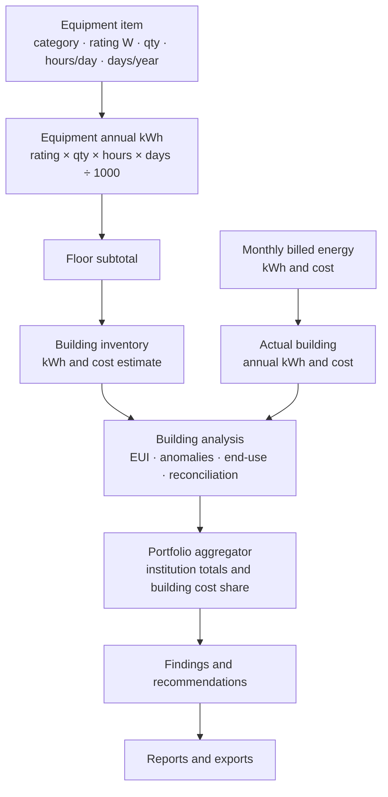
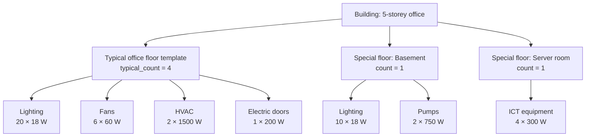

# Simplified Architecture — Energy Audit App

> **One-sentence version:** The app records the energy a building uses, breaks it down by floor and equipment, rolls it up to a building and then to the whole institution, and turns that into cost, EUI, anomalies, recommendations, and reports.

Related docs: [Full architecture](architecture.md) · [API reference](api.md) · [Formulas](formulas.md) · [What has been built](what-has-been-built.md)

This is the simplified, presentation-friendly version. It includes the full target design, even where features are not implemented yet. The status column shows what is already working.

## 1. Big picture

The core chain is:

```text
Equipment → floor → building → institution → findings → reports
```

A building starts with real equipment: lights, fans, HVAC units, electric doors, pumps, ICT equipment, and other loads. The system calculates each item’s annual energy use, rolls it up to a floor, multiplies repeated floors, adds special floors individually, and then combines the result with monthly utility bills.



## 2. Feature map: current and planned state

| Module | What it does | Status |
|---|---|---|
| Accounts and access | Institution sign-up, login, JWT bearer sessions, admin and auditor roles, forced password change | Implemented |
| Institution settings | Name, currency, standard electricity rate, maximum buildings | Implemented |
| Buildings | Create, edit, delete, limit enforcement, floor area, operating hours | Implemented |
| Monthly energy records | kWh and cost per month, CSV import, validation, confirmation, automatic KSh cost from standard rate | Implemented |
| Per-building analysis | Annual kWh and cost, EUI, monthly series, anomaly detection, coverage labels | Implemented |
| Portfolio dashboard | Institution totals, monthly chart, anomalies, building performance table | Implemented |
| Building comparison | EUI comparison, fairness warning when building types differ | Implemented |
| Floors | Typical-floor templates, special floors, floor areas, floor counts | Planned |
| Equipment inventory | Equipment by floor, category, rating, quantity, hours/day, days/year | Planned |
| Equipment calculations | Equipment kWh, floor subtotals, building inventory, end-use shares | Planned |
| Reconciliation | Compare billed kWh with inventory kWh, show gap | Planned |
| Building cost contribution | Show how each building contributes to institution cost | Planned |
| Audit findings | Checklist areas, problem, location, improvement, priority, optional photo | Planned |
| Recommendations | Measures library, estimated cost, estimated saving, payback, status, estimate label | Planned |
| Reports and exports | Building report preview, PDF/print, JSON/CSV export | Planned |
| Demo seed data | Demo institutions, buildings, energy records, equipment, findings, recommendations | Planned |
| Platform super-admin | Manage institutions across tenants, support access, platform reporting | Future |

Status meanings: **Implemented**, **Planned**, or **Future**.

## 3. Two data streams

| Stream | Source | Question it answers |
|---|---|---|
| Billed energy | Monthly utility records or CSV import: month, kWh, cost | How much did the building actually consume and cost? |
| Equipment inventory | Floor and equipment entries: rating, quantity, hours, days | Where is the energy going, and what can be improved? |

The equipment stream is bottom-up. The billed stream is top-down. Their difference is the reconciliation gap.

## 4. Floor model, calculations, and worked example

### 4.1 Floor types

| Floor type | Entry method | Multiply by floor count? |
|---|---|---|
| Typical floor | One template representing identical floors, e.g. “Typical office floor” | Yes |
| Special floor | Entered individually, e.g. Basement, Server room, Kitchen, Parking | No |

Core rule: enter equipment once for a typical floor, multiply by the number of identical floors, and enter special floors separately.



Equipment model:

| Entity | Key fields |
|---|---|
| Floor | Name, floor_type, typical_count, area_m2 |
| Equipment | Category, name, rating_w, qty, hours_day, days_year |

Floor workflow:

1. Create building: name, type, floor area, floor count, operating hours.
2. Add typical floor templates and set `typical_count`.
3. Add special floors individually.
4. Add equipment to each typical template and special floor.
5. Enter or import monthly bills.
6. Combine equipment and billed data in building analysis.
7. Aggregate buildings for institution.

### 4.2 Calculations and worked example

| Formula | Output |
|---|---|
| Equipment annual kWh | `rating_w × qty × hours_day × days_year ÷ 1000` |
| Equipment annual cost | `annual_kwh × standard_cost_per_kwh` |
| Typical floor kWh | Sum of equipment in template |
| Typical floor contribution | `template kWh × typical_count` |
| Special floor kWh | Sum of equipment on that floor |
| Building inventory kWh | Sum of typical contributions + special floors |
| Reconciliation gap | `(billed kWh − inventory kWh) ÷ billed kWh × 100` |
| Building cost contribution | `building total cost ÷ institution total cost × 100` |

Worked example: five-storey office with four typical office floors and one basement.

| Location | Equipment | Annual kWh |
|---|---|---:|
| Typical office floor | 20 lights, 18 W, 10 h/day, 250 days | 900.0 |
| Typical office floor | 6 fans, 60 W, 8 h/day, 250 days | 720.0 |
| Typical office floor | 2 HVAC units, 1500 W, 6 h/day, 250 days | 4,500.0 |
| Typical office floor | 1 electric door, 200 W, 2 h/day, 250 days | 100.0 |
| Basement | 10 lights, 18 W, 12 h/day, 365 days | 788.4 |
| Basement | 2 pumps, 750 W, 4 h/day, 365 days | 2,190.0 |

```text
Typical template = 900 + 720 + 4,500 + 100 = 6,220 kWh
Four floors     = 6,220 × 4 = 24,880 kWh
Basement        = 788.4 + 2,190 = 2,978.4 kWh
Building total  = 27,858.4 kWh
Inventory cost  = 27,858.4 × 21.84 = KSh 608,427.46
```

If billed kWh is 31,000:

```text
Reconciliation gap = (31,000 − 27,858.4) ÷ 31,000 × 100 = 10.1%
```

End-use shares:

| Category | Annual kWh | Share |
|---|---:|---:|
| Lighting | 4,388.4 | 15.8% |
| Fans | 2,880.0 | 10.3% |
| HVAC | 18,000.0 | 64.6% |
| Electric doors | 400.0 | 1.4% |
| Pumps | 2,190.0 | 7.9% |
| **Total** | **27,858.4** | **100%** |

Building cost contribution:

```text
Building A = KSh 608,427.46 → 60.3% of institution cost
Building B = KSh 400,000.00 → 39.7% of institution cost
Institution total = KSh 1,008,427.46
```

## 5. Stage outputs

| Stage | Input | Processing block | Output |
|---|---|---|---|
| 1 | Equipment input | Normalise and validate | Per-item kWh/cost |
| 2 | Item outputs + floor | Floor Rollup Engine | Per-floor kWh/cost |
| 3 | Floor outputs | Building Rollup Engine | Building inventory |
| 4 | Monthly bills | Energy Analysis Engine | Actual building kWh/cost, EUI, anomalies |
| 5 | Billed vs inventory | Reconciliation Engine | Gap, warning |
| 6 | Both streams | Building Analysis Layer | Building result |
| 7 | All buildings | Portfolio Aggregator | Institution totals, building cost share, comparison |
| 8 | Findings + baseline | Recommendation Engine | Savings, payback, status |
| 9 | All previous outputs | Report Builder | PDF/print, JSON/CSV export |

The key block is the **Portfolio Aggregator**: it turns building results into institution-level totals and cost contributions.

## 6. Building analysis and portfolio layer

Building analysis returns:

- Actual recorded kWh and cost
- Monthly series
- EUI and coverage
- Anomalies
- Inventory kWh and cost estimate
- End-use breakdown
- Floor summary
- Reconciliation gap
- Building cost contribution

Portfolio output:

- Institution total kWh and cost
- Building count and anomaly count
- Monthly chart
- Building performance table
- EUI comparison and fairness warning

## 7. Findings, recommendations, reports

Findings areas: lighting, AC/ventilation, motors/pumps, operating hours, practices.

Recommendations use measures library, estimated cost, estimated annual saving, payback, status, estimate label.

```text
Simple payback = estimated cost ÷ estimated annual saving
Cost = 0        → Immediate
Saving = 0      → Not applicable
Never divide by zero.
```

Report sections: building profile, consumption and cost summary, EUI and trend, end-use/reconciliation, findings, recommendations, conclusion, PDF/print, JSON/CSV export.

## 8. Roles, security, API

| Role | Scope |
|---|---|
| Admin | Institution settings, users, buildings, energy, equipment, audits, recommendations, reports |
| Auditor | Buildings, energy, equipment, audits, recommendations, reports |
| Platform super-admin | Future: manage institutions across tenants |

Security: JWT contains user, institution, role; institution always from token; cross-tenant access returns 404.

API areas: auth, institution/users, buildings, energy, analysis/dashboard, equipment/reconciliation, findings, recommendations/measures, reports/exports. More detail lives in [API reference](api.md).

## 9. Suggested presentation flow

| Slide | Diagram or example | Message |
|---|---|---|
| 1 | One-sentence version | We record energy, explain where it goes, turn it into decisions |
| 2 | Full data chain | Equipment to floor to building to institution to report |
| 3 | Two streams | Bills tell us what happened; equipment tells us why |
| 4 | Floor model | Typical floor multiplied; special floors separately |
| 5 | Worked example | 27,858.4 kWh, KSh 608,427.46, 10.1% reconciliation gap |
| 6 | Building analysis | Cost, EUI, anomalies, end-use, reconciliation |
| 7 | Portfolio | Institution totals and building cost contribution |
| 8 | Findings/reports | Recommendations, payback, reports |

## 10. Current status and out of scope

Current: accounts, settings, buildings, energy records, analysis, dashboard, comparison, 81 tests.

Planned: floors, equipment, reconciliation, cost contribution, findings, recommendations, reports/exports, seed.

Future: platform super-admin.

Out of scope: smart-meter integrations, carbon accounting, weather normalization, AI, NPV/IRR, approvals, email, offline, solar, client portal.

## 11. Recommended presentation note

> “The lower half of the chain is working. The upper half is designed and ready to build.”
